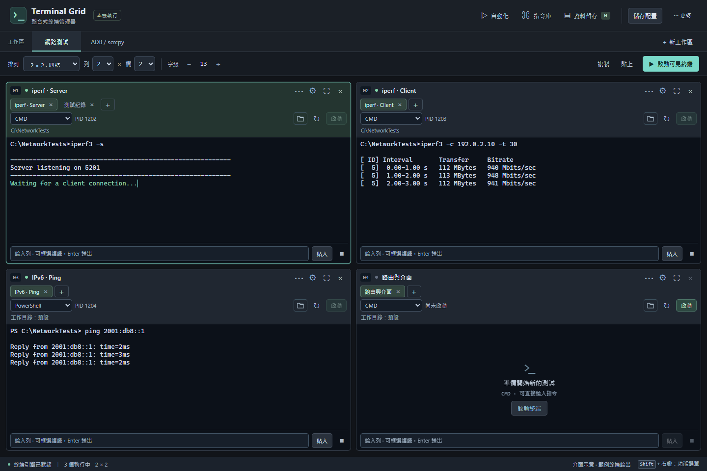

# Terminal Grid

在同一個 Windows 主視窗內，使用多個可直接操作的 CMD／PowerShell 終端。適合同時查看 Ping、DNS 查詢、路由追蹤與其他命令列工具。

**3.11.0**：拖曳標題交換整格、拖曳分頁移到另一格；標題／分頁右鍵可複製設定、剪下貼上、選擇跨工作區移動與關閉。移動保留程序和輸出，複製建立未啟動的新分頁。修正框選後直接打字及連續刪除／替換；更多的「本版操作／快捷說明」已同步更新。

複製使用設定中的啟動資料夾，不讀取 shell 臨時 `cd` 的路徑；移動則保留原程序的實際目錄。同工作區移動會更新流程目標；被流程引用的終端需先調整流程，才能跨工作區移動。原位編輯支援一般 CMD／PowerShell 提示字元的 ASCII 指令，Android shell、中文指令與歷史輸出請先帶到輸入列／草稿編輯。

**保留資料更新**：下載新版 ZIP，先完整解壓到另一資料夾，執行新版的 `Update.cmd`，選原本 `TerminalGridIntegrated.exe` 所在資料夾。更新會驗證套件、備份配置與被替換的程式檔，關閉舊版、覆蓋後重開；失敗則還原本次替換。原本工作區、自建指令、流程與介面偏好沿用本機資料目錄，其他個人檔案不刪除。也可先關閉舊版，手動完整覆蓋原程式資料夾。更新前請保存重要測試 Log，執行中程序與終端畫面不會跨重開恢復。



3.5 採用較清楚的深色工作台、工作區頁籤與目前終端焦點。常用功能放在頂部，配置匯入／匯出、說明與右鍵偏好收在「更多」。三列或三欄以上使用精簡標頭，資料夾與設定可從每格 ⋯ 選單開啟。

終端預設右鍵：**有框選文字就複製並解除框選；無框選文字就貼上**。**Shift＋右鍵、Shift＋F10 或每格 ⋯** 開啟原本的替換／暫存／指令選單。「更多 → 終端右鍵操作」可改回一般右鍵開選單，偏好只保留在本機，不隨配置匯出。多行貼上仍需確認。

視覺層次參考 [Fluent 2 間距](https://fluent2.microsoft.design/layout)與[字級](https://fluent2.microsoft.design/typography)規範；快速右鍵沿用 [VS Code Windows 終端的複製／貼上習慣](https://code.visualstudio.com/docs/terminal/basics)。介面由本專案實作，沒有加入遠端字型或外部圖片服務。

- 固定 1–4 列、1–4 欄，最多 16 格，提供四格、六格、九格與十二格配置。
- 可用上方「＋ 新工作區」建立多個命名工作區；右鍵工作區可重新命名、複製或刪除。複製會保留格數與終端設定，不會啟動程序。
- 每一格可加最多 8 個終端分頁。分頁在原格內切換，例如左上格的 CMD／scrcpy 命令終端不會移到右上格。
- 每格獨立的 Shell、工作目錄、名稱與選用啟動指令。
- 每格可按「從資料夾啟動」，用 Windows 資料夾選擇器指定本機目錄；終端設定內也提供「選擇資料夾」。
- 可直接輸入、Ctrl+C 中斷、複製貼上、調整字級與單格放大。
- 可直接框選終端中尚未送出的指令片段並原位替換。例如框選 `000111000` 中的 `111`，下方輸入 `222` 後按「替換」，結果是 `000222000`，不會追加在尾端或自動執行。也支援 Shift＋右鍵選單、Ctrl+V、Backspace／Delete 及暫存值拖曳。
- 每個終端分頁有獨立輸入列，可用滑鼠框選、Backspace／Delete 刪除及在任意位置貼上；Enter 送出指令，「貼入」只填入終端而不執行。上／下方向鍵可重用最近 50 筆輸入。
- 輸入列與指令草稿的右鍵選單支援手動替換、貼上及最近暫存值，優先列出相同類型；也可把側欄的值拖入選取範圍。
- 縮小格數後，隱藏終端繼續執行；停止工作階段後保留既有畫面。
- 配置儲存與 JSON 匯入／匯出；開啟工具、載入或匯入配置不會自動執行指令。
- 可編排啟動、輸入、等待時間、等待使用者操作後按「繼續」、結束等自動化步驟，儲存在本機或匯出／匯入 `.tgridflow` 流程檔。執行前會逐步顯示目標與指令並要求確認。
- 指令庫可新增、編輯、複製及重新命名指令包，並分享 `.tgridcmd`；在終端按 Shift＋右鍵、點選插入或拖曳指令只會填入文字，不會代替使用者按 Enter。
- 可將多個 `.tgridflow`／`.tgridcmd` 檔拖入主視窗匯入；流程仍需使用者檢視並明確執行。
- 「資料暫存」會從 `ifconfig`、`adb shell ifconfig`、`ip -6 addr`、`ipconfig` 的 IPv6 輸出行自動擷取位址，顯示來源工作區、格號、終端、介面與時間。可右鍵複製或拖入終端，也可手動暫存設備名稱等單行文字。
- 終端選取的指令可按 Shift＋右鍵選「帶到本格輸入列編輯」，或開啟「指令草稿」後替換其中的 A。草稿貼回原指定終端時不會按 Enter；終端重新啟動後需重新指定草稿目標。

## 下載與使用

3.9 新增原生「裝置檔案 · cfg／Logs」窗口，從「更多」或「指令庫」開啟。可讀取、搜尋與編輯 `/vendor/firmware/wifi.cfg`，檔名與路徑可改（含空格）；可載入 RD 的本機設定檔、另存草稿，備份後寫回並讀回驗證。傳輸頁提供 `/sdcard/log/`、`/data/debuglogger`、`/data/local/tmp/` 快捷路徑、Pull、Push 與目錄查詢。每次 Pull 新建序號／時間資料夾，避免覆蓋先前測試紀錄。Default 現有 12 包、99 條指令。

3.8 新增「自動化 → NAN／NDP 雙手機」：設定 DUT1／DUT2 後建立六格工作區與可修改、匯出的流程。開啟兩台 scrcpy → 等待 APK 建立 NAN／NDP → 按繼續即時查 DUT1 Aware IPv6 並在 DUT2 持續 ping6 → 確認 server／ping 後送 iperf3 或 iperf 2 流量。預設 `-f m -n 1300M`，可改手機工具路徑、Port、兩端介面與傳輸量；Quick Share 模式由使用者手動傳檔。11 個 Default 分類共 89 指令包含 NAN 專用包。

NAN 功能隨 GUI 附帶 `TerminalGridNan.exe`，需保留在主程式旁。它在指定手機查介面，使用 DUT2 的 `%aware_data0` 等 Android scope，透過獨立終端前景程序顯示 Ping／Server／Traffic。啟動時重新取 IP，無固定舊 IP；無位址或多個候選則顯示原因。ADB、scrcpy 與手機 iperf 仍需先安裝。實機 NAN／Quick Share 行為需依手機、APK 與韌體驗收。

3.7.2 插入 Ping／Ping -6 範本時可選擇自動偵測的 ADB 裝置與 IP：ADB 已授權在線裝置、本機啟用中的網卡、ADB TCP/IP 裝置位址及暫存區 IP，並保留手動輸入／重新偵測。IPv6 link-local 會自動補 Windows 數字介面 scope（例如 `%12`），選單同時顯示 WLAN／LAN 名稱。`-B` 本機綁定位址獨立選擇。本機網卡不代表遠端 server 可達，USB 裝置的網路 IP 需先查詢並暫存或手動輸入。偵測只列舉網卡與 `adb devices -l`，不掃描網段。

舊指令中的 `DEVICE_SERIAL`、`SERVER_IP`、`LOCAL_IP`、`DEVICE_IP` 及內建示例 `192.0.2.10`／`192.0.2.20`／`2001:db8::10` 會在插入時轉成參數選擇；其他已填妥的固定 IP 保留。自動化的「輸入指令」步驟會先選參數，再顯示實際指令確認，範本不會被實值覆寫。

3.6 隨附 10 個 Default 指令包、81 條 SQA 範本：ADB、scrcpy、iperf 2、iperf3、Windows 網路，各分常用／進階。內建包可插入、拖曳、匯出或複製後修改；個人包仍可編輯，更新不會覆蓋。APK 安裝、push／pull、bugreport 與 scrcpy 錄影提供路徑填入視窗，可選本機檔案／資料夾，並編輯裝置序號、遠端路徑；完成後只插入、不執行。工具本身需另行安裝。

「更多 → 顯示每格輸入列」可隱藏／顯示底部輸入列，偏好會保留；隱藏後仍可直接操作終端或使用 Shift＋右鍵選單。

更新方式：關閉舊程式後，把新版 Windows GUI ZIP 完整解壓縮到原程式資料夾並啟動 EXE，或在原始碼工作副本執行 `UpdateAndLaunch.ps1`。工作區、流程、自建指令保存在 `%LOCALAPPDATA%\TerminalGridIntegrated\layout.json`（使用 `TERMINALGRID_DATA_DIR` 時以指定目錄為準），不隨下載 ZIP 提供；更新會沿用此資料。更新腳本另備份到該資料目錄的 `backups`，不刪除舊資料。本版無資料格式遷移或必要刪除。

本專案對使用者只提供 Windows 本機 GUI。GitHub Releases 的正式使用入口是 `TerminalGridIntegrated.exe`；`ui` 資料夾內的 HTML、JavaScript 與 CSS 是 GUI 內嵌 WebView2 的私有介面資源，不能當成獨立網頁版使用，也不會另外發布 HTML 下載包。請從解壓縮後的 EXE 啟動，並保留同層 DLL 與 `ui` 資料夾。

原位替換目前辨識 CMD／PowerShell 的一般磁碟或 UNC 路徑提示字元，支援由英文、數字、符號及空格組成的單行指令；工作路徑可含中文。歷史輸出、自訂提示字元、全螢幕互動程式及含非 ASCII 字元的指令，請使用可編輯輸入列或草稿。選取後若有新輸出、其他輸入、縮放或重啟，需重新框選。

3.4.1 修正 CMD 覆寫模式的尾段保留，以及取消／重選後延遲剪貼簿仍修改舊位置的問題。原位替換只接受連續選取；Alt 矩形選取不會送出編輯鍵。若畫面無法區分真正的行尾空白與刪字留下的空白，會提示改用輸入列或草稿，不猜測指令長度。

1. 從 [Releases](https://github.com/kdeppaei/terminal-grid/releases/latest) 下載 Windows x64 ZIP。
2. 完整解壓縮，保留 DLL 與 `ui` 資料夾。
3. 執行 `TerminalGridIntegrated.exe`，選擇工作區與格數，再按各格的「啟動」。

若要從指定資料夾開始，按該格的資料夾按鈕，選擇本機資料夾後即可啟動。各格目錄會個別記住；若該格已在執行，只更新下次啟動目錄，既有測試繼續執行。也可在齒輪設定中選擇資料夾後按「儲存設定」。

一般網路測試可使用標準使用者權限。本工具沒有安裝程式；需要 Windows 10 1809 以上的 64 位元 Windows、.NET Framework 4.8 及已安裝的 WebView2 Runtime。PowerShell 7 為選用元件。

關閉主程式時，若仍有工作階段會先提示；確認後會結束本工具建立的終端與子程序。此版本建立新的內建工作階段，無法接管既有的外部終端視窗。

[完整操作說明](使用說明.md) · [scrcpy 同格整合可行性檢視](SCRCPY_INTEGRATION_SPIKE.md) · [四格網路測試範例](examples/四格網路測試.json) · [驗證紀錄](驗證紀錄.md)

更新本機工作副本時，可執行 `UpdateAndLaunch.ps1`：它會先編譯暫存新版，再要求關閉目前從此資料夾啟動的舊版，替換程式並啟動新版。若舊版有執行中的終端，請在主視窗確認結束；若關閉未完成，更新會中止且不會強制結束程序。

## 公司環境與權限

MIT 允許企業使用、修改與散布本專案的原始程式碼；使用或散布時請保留授權文字。公司是否核准公開原始碼、下載與執行此工具，仍依公司的智慧財產、軟體、端點及權限管理規範判定。公開發布與 MIT 授權不代表已通過公司內部資安審核。

- 程式 manifest 使用 `asInvoker`，沒有內建提權功能。Shell 繼承啟動者的 Windows 權限；若從已提升權限的環境啟動，子程序也可能具有相同權限。
- 本專案自行撰寫的介面程式沒有遙測、更新服務或監聽網路連接埠。終端由使用者執行的命令可存取網路；WebView2 Runtime 仍有其自身的系統元件行為。
- 發布的 EXE 目前沒有 Authenticode 簽章。公司需要程式簽章或允許清單時，請依公司流程辦理；MIT 授權不會取代這些要求。
- 配置與選用的 CMD 啟動指令檔存放在 `%LOCALAPPDATA%\TerminalGridIntegrated`。終端畫面不會由本工具自動寫入紀錄檔；Shell 自身及使用者命令可能另有歷史或紀錄。
- PowerShell 的選用啟動指令以 `-EncodedCommand` 傳入，僅為保留中文與引號；沒有加入 `-ExecutionPolicy Bypass`。是否允許此命令形式仍依公司端點政策。

## 從原始碼建置

在允許執行 PowerShell 建置腳本的 Windows 環境中：

```powershell
.\Build.ps1
```

使用本機 .NET Framework C# 編譯器及本倉庫隨附的 WebView2 SDK DLL；建置不會下載套件。PowerShell 執行政策若禁止腳本，請使用公司核准的建置環境。

```powershell
.\Test.ps1 -ConfigOnly  # 配置模型測試，不啟動終端
.\Test.ps1              # 配置與本機終端互動測試
.\Test.ps1 -Stress      # 加跑每輪 16 格的並行測試
.\Package.ps1           # 建置並產生 ZIP 與 SHA-256 校驗檔
```

測試說明位於 [tests/README.md](tests/README.md)。GitHub Actions 會在 Windows runner 上建置、執行測試及建立下載產物。

## 授權

本專案自行撰寫的程式碼以 [MIT License](LICENSE) 提供。第三方元件維持各自原有授權，請參閱 [THIRD_PARTY_NOTICES.md](THIRD_PARTY_NOTICES.md) 與 `licenses/`。WebView2 Runtime 為獨立系統相依元件。
