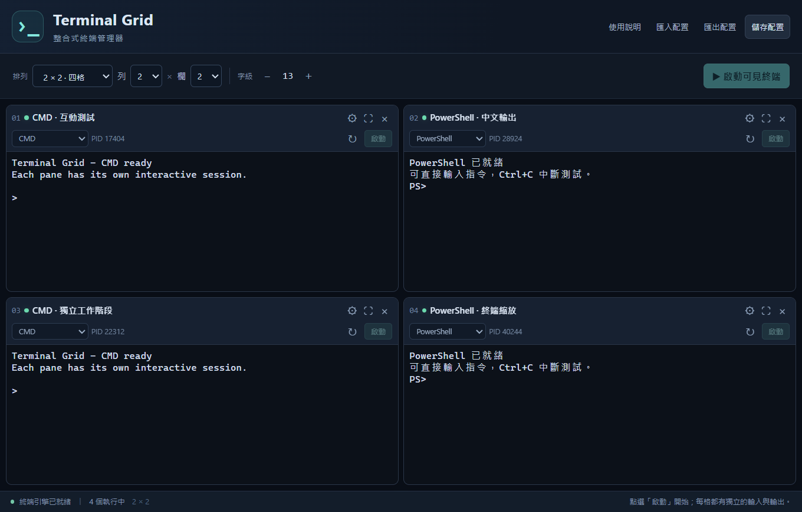

# Terminal Grid

在同一個 Windows 主視窗內，使用多個可直接操作的 CMD／PowerShell 終端。適合同時查看 Ping、DNS 查詢、路由追蹤與其他命令列工具。



- 固定 1–4 列、1–4 欄，最多 16 格，提供四格、六格、九格與十二格配置。
- 可用上方「＋ 新工作區」建立多個命名工作區；右鍵工作區可重新命名、複製或刪除。複製會保留格數與終端設定，不會啟動程序。
- 每一格可加最多 8 個終端分頁。分頁在原格內切換，例如左上格的 CMD／scrcpy 命令終端不會移到右上格。
- 每格獨立的 Shell、工作目錄、名稱與選用啟動指令。
- 每格可按「從資料夾啟動」，用 Windows 資料夾選擇器指定本機目錄；終端設定內也提供「選擇資料夾」。
- 可直接輸入、Ctrl+C 中斷、複製貼上、調整字級與單格放大。
- 縮小格數後，隱藏終端繼續執行；停止工作階段後保留既有畫面。
- 配置儲存與 JSON 匯入／匯出；開啟工具、載入或匯入配置不會自動執行指令。
- 可編排啟動、輸入、等待時間、等待使用者操作後按「繼續」、結束等自動化步驟，儲存在本機或匯出／匯入 `.tgridflow` 流程檔。執行前會逐步顯示目標與指令並要求確認。
- 指令庫可新增、編輯、複製及重新命名指令包，並分享 `.tgridcmd`；在終端按右鍵、點選插入或拖曳指令只會填入文字，不會代替使用者按 Enter。
- 可將多個 `.tgridflow`／`.tgridcmd` 檔拖入主視窗匯入；流程仍需使用者檢視並明確執行。
- 「資料暫存」會從 `ifconfig`、`adb shell ifconfig`、`ip -6 addr`、`ipconfig` 的 IPv6 輸出行自動擷取位址，顯示來源工作區、格號、終端、介面與時間。可右鍵複製或拖入終端，也可手動暫存設備名稱等單行文字。
- 「指令草稿」可帶入終端選取的指令，框選其中的 A，再右鍵選暫存 B 或拖入，精確替換成 `ping B`。貼回原指定終端時不會按 Enter；終端重新啟動後需重新指定目標。

## 下載與使用

1. 從 [Releases](https://github.com/kdeppaei/terminal-grid/releases/latest) 下載 Windows x64 ZIP。
2. 完整解壓縮，保留 DLL 與 `ui` 資料夾。
3. 執行 `TerminalGridIntegrated.exe`，選擇工作區與格數，再按各格的「啟動」。

若要從指定資料夾開始，按該格的資料夾按鈕，選擇本機資料夾後即可啟動。各格目錄會個別記住；若該格已在執行，只更新下次啟動目錄，既有測試繼續執行。也可在齒輪設定中選擇資料夾後按「儲存設定」。

一般網路測試可使用標準使用者權限。本工具沒有安裝程式；需要 Windows 10 1809 以上的 64 位元 Windows、.NET Framework 4.8 及已安裝的 WebView2 Runtime。PowerShell 7 為選用元件。

關閉主程式時，若仍有工作階段會先提示；確認後會結束本工具建立的終端與子程序。此版本建立新的內建工作階段，無法接管既有的外部終端視窗。

[完整操作說明](使用說明.md) · [scrcpy 同格整合可行性檢視](SCRCPY_INTEGRATION_SPIKE.md) · [四格網路測試範例](examples/四格網路測試.json) · [驗證紀錄](驗證紀錄.md)

更新本機工作副本時，可執行 `UpdateAndLaunch.ps1`：它會先編譯暫存新版，再要求關閉目前從此資料夾啟動的舊版，替換程式並啟動新版。若舊版有執行中的終端，請在主視窗確認結束；若關閉未完成，更新會中止且不會強制結束程序。

## 公司環境與權限

MIT 允許企業使用、修改與散布本專案的原始程式碼；使用或散布時請保留授權文字。公司是否核准公開原始碼、下載與執行此工具，仍依公司的智慧財產、軟體、端點及權限管理規範判定。公開發布與 MIT 授權不代表已通過公司內部資安審核。

- 程式 manifest 使用 `asInvoker`，沒有內建提權功能。Shell 繼承啟動者的 Windows 權限；若從已提升權限的環境啟動，子程序也可能具有相同權限。
- 本專案自行撰寫的介面程式沒有遙測、更新服務或監聽網路連接埠。終端由使用者執行的命令可存取網路；WebView2 Runtime 仍有其自身的系統元件行為。
- 發布的 EXE 目前沒有 Authenticode 簽章。公司需要程式簽章或允許清單時，請依公司流程辦理；MIT 授權不會取代這些要求。
- 配置與選用的 CMD 啟動指令檔存放在 `%LOCALAPPDATA%\TerminalGridIntegrated`。終端畫面不會由本工具自動寫入紀錄檔；Shell 自身及使用者命令可能另有歷史或紀錄。
- PowerShell 的選用啟動指令以 `-EncodedCommand` 傳入，僅為保留中文與引號；沒有加入 `-ExecutionPolicy Bypass`。是否允許此命令形式仍依公司端點政策。

## 從原始碼建置

在允許執行 PowerShell 建置腳本的 Windows 環境中：

```powershell
.\Build.ps1
```

使用本機 .NET Framework C# 編譯器及本倉庫隨附的 WebView2 SDK DLL；建置不會下載套件。PowerShell 執行政策若禁止腳本，請使用公司核准的建置環境。

```powershell
.\Test.ps1 -ConfigOnly  # 配置模型測試，不啟動終端
.\Test.ps1              # 配置與本機終端互動測試
.\Test.ps1 -Stress      # 加跑每輪 16 格的並行測試
.\Package.ps1           # 建置並產生 ZIP 與 SHA-256 校驗檔
```

測試說明位於 [tests/README.md](tests/README.md)。GitHub Actions 會在 Windows runner 上建置、執行測試及建立下載產物。

## 授權

本專案自行撰寫的程式碼以 [MIT License](LICENSE) 提供。第三方元件維持各自原有授權，請參閱 [THIRD_PARTY_NOTICES.md](THIRD_PARTY_NOTICES.md) 與 `licenses/`。WebView2 Runtime 為獨立系統相依元件。
